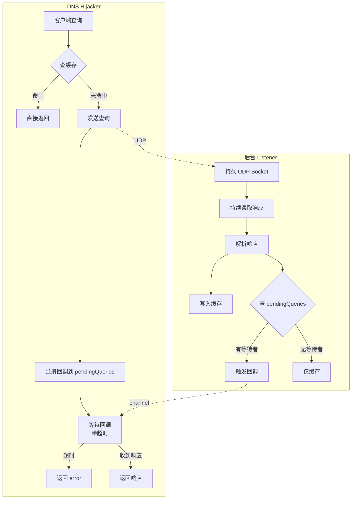

> 版本: v0.1.0
> 日期: 2026-10-16
> 状态: DRAFT
> 负责人: Phaethon Dev

# Mesh DNS 异步转发架构设计

## 变更记录

| 版本 | 日期 | 变更内容 | 作者 |
|------|------|----------|------|
| v0.1.0 | 2026-10-16 | 初始版本（异步转发 + 持续监听） | Phaethon Dev |

## 1. 背景与问题

### 1.1 当前架构（同步阻塞）

当前 mesh DNS 转发采用**同步阻塞**模式：

```go
// mesh/dns.go:forwardToRemote
const timeout = 3 * time.Second
conn, err := gonet.DialUDP(...)
defer conn.Close()
conn.SetDeadline(time.Now().Add(timeout))
conn.Write(query)
n, err := conn.Read(resp)  // 阻塞等待
if err != nil {
    return nil, 0, err  // 超时返回 error
}
// 成功则缓存
h.cache.Set(domain, remoteIP, ttl)
```

**问题：**
1. **超时浪费响应**：3 秒超时后返回 error，但远程节点仍会处理并返回响应
2. **迟到响应被丢弃**：连接已关闭，迟到响应到达后被 netstack 丢弃
3. **重复查询**：下次查询还会再次超时（未缓存）
4. **效率低**：每次查询都建立新连接

### 1.2 实际场景

MS9/MS10 环境上传包时，`nslookup gg.phn` 甚至 `jf.phn` 超时：
- P2P 连接可能需要先建立
- 多跳中继增加延迟
- 3 秒超时太短
- 但简单增加超时不是根本解决方案

## 2. 目标

1. **不浪费响应**：所有 DNS 响应都应被接收和缓存
2. **快速重试**：超时后的迟到响应仍可用于后续查询
3. **高效连接**：使用持久监听，避免每次查询建连接
4. **向后兼容**：不改变现有 API 和行为

## 3. 架构设计

### 3.1 核心思路

**异步转发 + 持续监听**：
- 后台 goroutine 持续监听所有 DNS 响应
- 响应到达：缓存 + 触发等待中的客户端
- 客户端查询：查缓存 → 未命中则发送 + 等待回调

### 3.2 架构图



### 3.3 数据结构

```go
type DNSHijacker struct {
    // ... 现有字段 ...
    
    // 异步转发相关
    forwarderSocket  tcpip.Endpoint           // 持久 UDP socket
    pendingQueries   map[string]chan dnsResult // domain -> callback
    pendingMu        sync.Mutex                // 保护 pendingQueries
    forwarderStopCh  chan struct{}             // 停止后台 listener
}

type dnsResult struct {
    ip  net.IP
    ttl time.Duration
    err error
}
```

### 3.4 核心流程

#### 3.4.1 后台 Listener 启动

```go
func (h *DNSHijacker) startForwarder() {
    go func() {
        buf := make([]byte, 512)
        for {
            select {
            case <-h.forwarderStopCh:
                return
            default:
            }
            
            // 持续读取响应
            n, from, err := h.forwarderSocket.Read(buf)
            if err != nil {
                continue
            }
            
            // 解析响应
            domain, ip, ttl := parseDNSResponse(buf[:n])
            
            // 1. 写入缓存
            h.cache.Set(domain, ip, ttl)
            
            // 2. 触发等待中的客户端
            h.pendingMu.Lock()
            if ch, ok := h.pendingQueries[domain]; ok {
                select {
                case ch <- dnsResult{ip: ip, ttl: ttl}:
                default:
                }
                delete(h.pendingQueries, domain)
            }
            h.pendingMu.Unlock()
        }
    }()
}
```

#### 3.4.2 客户端查询

```go
func (h *DNSHijacker) forwardToRemote(subnet *net.IPNet, query []byte) (net.IP, time.Duration, error) {
    domain := parseDomain(query)
    
    // 1. 检查缓存（可能已被后台 listener 缓存）
    if ip, ttl := h.cache.Get(domain); ip != nil {
        return ip, ttl, nil
    }
    
    // 2. 注册回调
    resultCh := make(chan dnsResult, 1)
    h.pendingMu.Lock()
    h.pendingQueries[domain] = resultCh
    h.pendingMu.Unlock()
    
    // 3. 发送查询（通过持久 socket）
    h.forwarderSocket.Write(query, ...)
    
    // 4. 等待回调（带超时）
    select {
    case result := <-resultCh:
        return result.ip, result.ttl, result.err
    case <-time.After(5 * time.Second):
        // 超时，但后台继续监听
        h.pendingMu.Lock()
        delete(h.pendingQueries, domain)
        h.pendingMu.Unlock()
        return nil, 0, fmt.Errorf("timeout")
    }
}
```

## 4. 实现计划

### 4.1 阶段 1：基础设施

1. 添加 `forwarderSocket`、`pendingQueries` 等字段
2. 实现 `startForwarder()` 后台 listener
3. 在 `BindNetstack()` 中初始化并启动

### 4.2 阶段 2：重构转发逻辑

1. 修改 `forwardToRemote()` 为异步模式
2. 移除每次查询的连接建立
3. 使用持久 socket 发送

### 4.3 阶段 3：测试验证

1. 单元测试：缓存命中、超时、迟到响应
2. 集成测试：mesh DNS 解析
3. 部署到测试环境验证

## 5. 风险与缓解

| 风险 | 影响 | 缓解措施 |
|------|------|----------|
| 后台 listener 崩溃 | DNS 转发完全失败 | 添加 panic recovery + 自动重启 |
| pendingQueries 泄漏 | 内存增长 | 超时后清理 + 定期清理过期条目 |
| 并发问题 | 数据竞争 | 使用 mutex 保护共享状态 |
| 向后兼容 | 现有功能受影响 | 保留原有同步接口作为 fallback |

## 6. 超时时间建议

异步架构下，超时时间可以更灵活：
- **客户端等待超时**：5 秒（比当前 3 秒宽松）
- **后台监听**：无超时（持续监听）
- **迟到响应**：仍会被缓存，下次查询直接命中

## 7. 预期效果

1. **首次查询**：可能超时（5 秒），但响应会被缓存
2. **第二次查询**：直接命中缓存，毫秒级返回
3. **资源利用**：单个持久连接，更高效
4. **用户体验**：即使首次超时，后续查询快速返回
